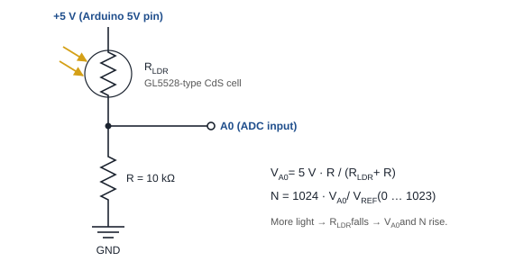
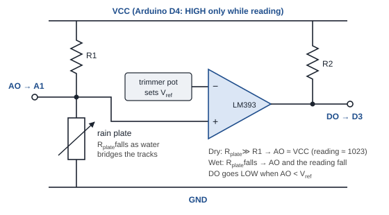
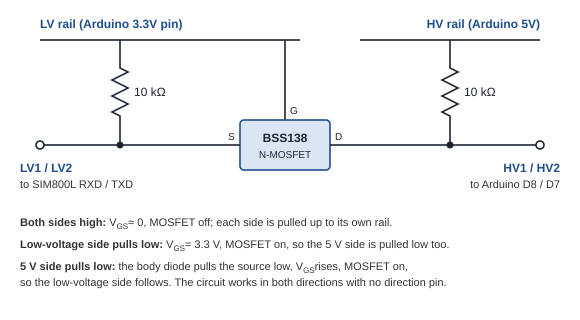
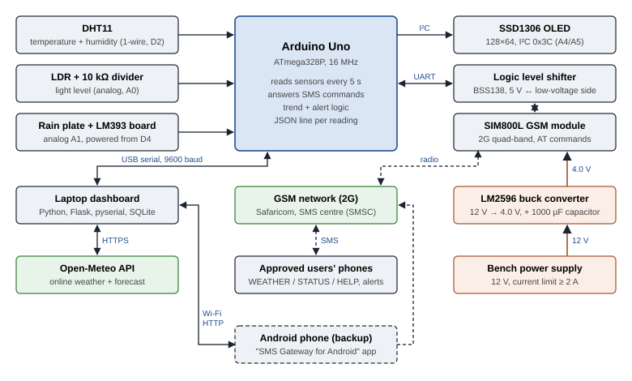
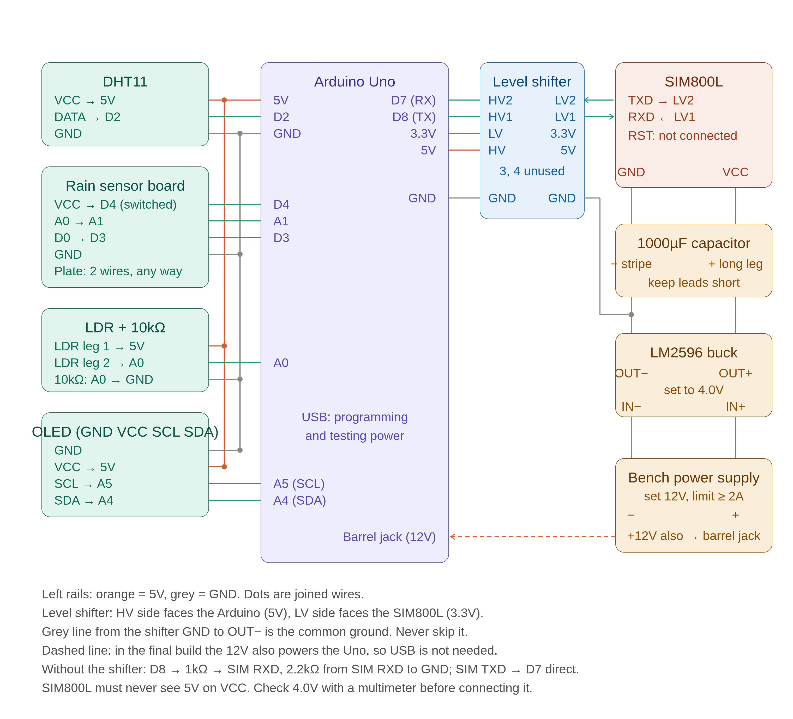
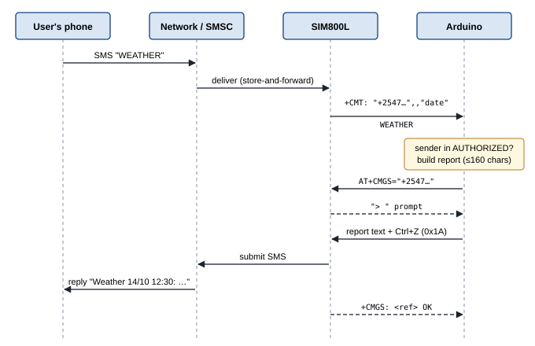
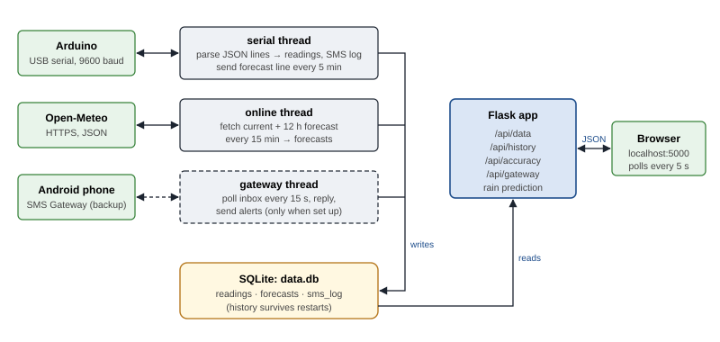

<div class="titleblock" markdown="1">

# SMS-Based Weather Report Information System

**An Arduino weather station with a GSM text-message interface and a forecast-comparison dashboard**

*EEIC/7301 Project Design & Evaluation*

*Project report, October 2026*

*[Student name and registration number]*

</div>

<div class="abstract" markdown="1">

**Abstract.** This report describes the design, construction and evaluation of a low-cost weather station built around an Arduino Uno. The station measures temperature, relative humidity, light level and rainfall, shows the readings on a 0.96-inch OLED display, and answers text-message (SMS) commands from an approved list of phone numbers through a SIM800L GSM module, so that a weather report can be obtained from any basic mobile phone without internet access. It also sends automatic SMS alerts when rain starts, when the temperature crosses set limits, or when the light level drops sharply. A laptop dashboard written in Python logs every reading to a database, fetches an online numerical weather forecast from the Open-Meteo service, compares the station's measurements with it, scores the forecast's accuracy with the mean absolute error, and combines the sensor readings and the forecast into a simple rule-based rain indicator. The report explains the physical principles behind each sensor and interface, gives the full wiring with explanations, describes the firmware and software, and presents the test results. All module tests that do not need the GSM radio passed on the hardware; the first SIM800L module was found to be faulty (its transmit output stuck at 0 V) and an Android-phone SMS gateway was implemented as a working backup path. Total component cost was about KES 6,600.

</div>

## 1. Introduction

### 1.1 Background

Weather information matters to farmers, students, travellers and anyone planning outdoor work, yet Africa has one of the sparsest networks of official weather stations in the world, which limits both local observations and the accuracy of forecasts for a given place [@tahmo]. In Kenya, intercomparison studies of automatic weather stations against synoptic stations have been carried out precisely because more and cheaper stations are needed to fill the gaps [@muita]. At the same time, low-cost microcontroller boards and sensors have made it practical for students and small organisations to build their own stations [@santos, @ioannou], and studies in low-income economies have shown that open, non-conventional stations can give useful data when their limits are understood [@strigaro].

A second observation motivates the SMS interface. Not everyone has a smartphone or a data bundle, but almost every mobile phone can send and receive SMS over the 2G GSM network. A weather station that answers a text message therefore reaches more people than a web page would. Earlier student and research projects have used GSM modules to send environmental readings by SMS [@nasirudin, @oo], and remotely queried low-cost stations have been described in the literature [@krejcar].

### 1.2 Problem statement

Design and build a weather station that (a) measures the local temperature, humidity, light and rain; (b) can be queried by SMS from an ordinary phone and replies with a one-message weather report; (c) raises automatic alerts; and (d) lets the user compare the local readings with an online forecast and judge how accurate that forecast is for this location.

### 1.3 Objectives

1. Measure temperature, relative humidity, light level and rain with low-cost sensors and show them on a local display.
2. Receive SMS commands from approved numbers through a GSM module and reply with a report that fits in one SMS (160 characters) [@ts23040].
3. Send automatic alerts for rain starting, temperature limits and a sharp drop in light, with rate limiting.
4. Log all readings on a laptop, fetch an online forecast, compare the two, and compute a forecast-accuracy score.
5. Test each module on its own before integration, and document the results.

### 1.4 Scope and limitations

The station is a prototype on a breadboard and runs from a bench power supply; weatherproofing and outdoor mounting are future work. Sensor accuracy is that of hobby-grade parts (Section 3) and is discussed in Section 8. The dashboard needs a laptop with internet access; the station itself works without it.

## 2. Related work

Low-cost weather stations built on microcontrollers are now a well-established topic. Santos and Ferreira describe a station built from common modules and discuss its feasibility for education [@santos]; Ioannou *et al.* review low-cost automatic stations in the Internet of Things and their validation [@ioannou]; Krejcar presents a low-cost station with remote control [@krejcar]; Marwa *et al.* apply one to smart agriculture [@marwa]; and Suparta *et al.* build an Arduino station for precipitable-water monitoring in Indonesia [@suparta]. GSM has been used as the data link in environmental monitoring, for example for fresh-water monitoring [@nasirudin], and Oo *et al.* describe an Arduino-plus-GSM SMS alarm system for a weather station, which is the closest architecture to this project [@oo].

The quality of non-standard observations is a recurring concern. Bell *et al.* examine automated amateur weather observations and the siting and sensor problems that affect them [@bell], and Muller *et al.* review crowdsourced atmospheric data and what it can and cannot be used for [@muller]. For the humidity sensors used in such stations, Koestoer *et al.* show that DHT-series sensors need calibration in tropical climates [@koestoer], and Vajs *et al.* show that low-cost temperature and humidity sensors carry systematic biases that can be corrected [@vajs]. Standard exposure and siting practice for meteorological instruments is laid down in the WMO guide [@wmo8]. This project follows that literature in two ways: every sensor was tested on its own first, and the dashboard measures the difference between the station and an independent forecast rather than assuming either is right.

## 3. Theory of operation

### 3.1 The microcontroller and its analog-to-digital converter

The Arduino Uno R3 is built around the Microchip ATmega328P, an 8-bit AVR microcontroller running at 16 MHz with 32 KB of flash program memory, 2 KB of SRAM, 1 KB of EEPROM, a USART, a two-wire (I²C) interface and a 10-bit analog-to-digital converter (ADC) [@atmega, @unoman]. The board supplies regulated 5 V and 3.3 V rails and connects to a computer through a USB-to-serial bridge [@unodoc]. Programming follows the usual `setup()`/`loop()` sketch structure [@monk, @banzi].

The ADC compares an input voltage *V* with a reference *V*<sub>REF</sub> (5 V here) and returns an integer

> *N* = ⌊1024 · *V* / *V*<sub>REF</sub>⌋, 0 ≤ *N* ≤ 1023,

so one count is about 4.9 mV [@atmega]. Two of the station's sensors (light and rain) are resistive and are read through this converter using a voltage divider, described next.

### 3.2 Voltage dividers and the light sensor

A light-dependent resistor (LDR) is a cadmium-sulphide photoresistor whose resistance falls as the light falling on it increases [@fraden]: the GL5528-type cell used here is specified at 10–20 kΩ at 10 lux and about 1 MΩ in the dark [@gl5528]. Resistance cannot be read directly by an ADC, so the LDR is placed in series with a fixed 10 kΩ resistor across the 5 V rail (Fig. 2), forming a voltage divider [@horowitz]:

> *V*<sub>A0</sub> = 5 V · *R* / (*R*<sub>LDR</sub> + *R*).

In the dark, *R*<sub>LDR</sub> ≈ 1 MΩ gives *V*<sub>A0</sub> ≈ 0.05 V (*N* ≈ 10); at 10 lux (*R*<sub>LDR</sub> ≈ 15 kΩ) *V*<sub>A0</sub> ≈ 2 V (*N* ≈ 410); in bright room light the cell drops to a few kΩ and *N* approaches 900. The measured room-light value of about 880 counts (Section 7) agrees with this. The response is strongly non-linear in lux, so the firmware does not try to compute lux; it maps the raw count linearly to a 0–100 % "light level" between two calibration points, which is enough for trend and storm-warning logic. LDR-based light measurement on Arduino is a standard arrangement [@singh].

<figure markdown="1">

<figcaption>Fig. 2. The light sensor: an LDR and a 10 kΩ resistor form a voltage divider whose mid-point is read by ADC input A0.</figcaption>
</figure>

### 3.3 The rain sensor

The rain sensor consists of a printed sensing plate with two interleaved, uncoated copper tracks and a small comparator board (Fig. 3). Dry, the resistance between the tracks is very high; when water bridges them, it falls sharply, because rain water conducts through its dissolved ions. On the board the plate is the lower leg of a divider with a fixed pull-up resistor, so the analog output AO sits near the supply when dry (a reading of about 1010–1020 was measured) and falls as the plate gets wetter. The board also contains an LM393 comparator [@lm393] whose reference is set by a trimmer potentiometer; its open-collector output DO is pulled up by a resistor and goes LOW when AO drops below the reference, giving a simple wet/dry flag [@horowitz]. The firmware uses the analog value, which it sorts into classes by thresholds, and keeps DO only as a wiring reference.

Passing current through wet copper tracks causes electrolysis and corrosion, a known failure mode of these plates. To slow it, the board's supply is not wired to 5 V but to an Arduino digital pin (D4) that is switched HIGH for about 100 ms every 5 s, only while the reading is taken.

<figure markdown="1">

<figcaption>Fig. 3. Rain sensor: the plate's resistance sets the analog output AO; an LM393 comparator gives the digital flag DO.</figcaption>
</figure>

### 3.4 Temperature and humidity: the DHT11

The DHT11 is a packaged sensor containing a resistive humidity element, an NTC thermistor and a small 8-bit controller that performs the measurement and sends the result digitally over a single data wire [@dht11]. Its manufacturer specifies ±5 % RH and ±2 °C accuracy and asks for at least two seconds between readings [@dht11]; the sensor reports whole units of % RH and °C, as the test output in Section 7 shows. The firmware reads it every 5 s through the Adafruit DHT library [@dhtlib].

The single-wire protocol works by timing: the microcontroller pulls the line low to request a reading, the sensor replies with a start pulse and then 40 bits (16 for humidity, 16 for temperature, 8 checksum), each bit encoded by the length of a high pulse [@dht11]. Because the bit timing is measured in software, interrupts are disabled for a few milliseconds during the read; this interacts with the software serial port used for the GSM module (Section 5.4).

Relative humidity is the ratio of the actual water-vapour pressure to the saturation vapour pressure at the same temperature [@wallace]. The saturation pressure rises steeply with temperature and is well approximated by the Magnus form *e*<sub>s</sub>(*T*) = 6.1094 exp(17.625 *T* / (*T* + 243.04)) hPa, with the coefficients of Alduchov and Eskridge [@alduchov]; from RH and *T* the dew point can be computed, or, for RH above about 50 %, estimated by the rule *T*<sub>d</sub> ≈ *T* − (100 − RH)/5 [@lawrence]. The dashboard does not yet compute dew point, but these relationships explain why rising humidity at falling temperature is a useful rain sign (Section 6.3) and why indoor and outdoor humidity differ so much (Section 7.5).

### 3.5 The I²C bus and the OLED display

The 0.96-inch, 128 × 64-pixel OLED is driven by a Solomon Systech SSD1306 controller, which holds the display image in its own graphics RAM and accepts commands and pixel data over an I²C interface at the 7-bit address 0x3C [@ssd1306]. I²C is a two-wire bus (SDA data, SCL clock) in which every device has open-drain outputs and the lines are pulled up to the supply by resistors; the master (the Arduino) generates the clock and addresses each slave by a 7-bit address followed by a read/write bit [@i2c]. On the Uno, SDA and SCL are shared with analog pins A4 and A5 [@unoman]. The I²C scanner in test 02 found the display at 0x3C.

Driving the display is mainly a memory question. A full frame buffer for 128 × 64 pixels needs 1024 bytes, half of the ATmega328P's 2 KB SRAM. The integration test with the Adafruit SSD1306 library (which keeps such a buffer) left about 450 bytes free, too little once the GSM code and its line buffers were added, so the final firmware uses the U8g2 library in its text-only U8x8 mode, which writes characters straight to the controller's RAM without a buffer [@u8g2]. At run time the firmware then has about 760 bytes free.

### 3.6 GSM and the Short Message Service

GSM is a digital cellular standard in which each 200 kHz radio channel is shared by time-division multiple access: a frame of 4.615 ms is divided into eight time slots, and a mobile transmits in one slot, i.e. in short bursts [@eberspacher, @sauter]. This burst transmission is why a GSM module's current demand is so spiky (Section 3.7). In Kenya the station uses the Safaricom 2G network.

The Short Message Service carries up to 140 octets per message, which is 160 characters in the 7-bit GSM alphabet, through a store-and-forward Short Message Service Centre (SMSC) [@ts23040]. A modem is controlled by its host through AT commands; the SMS-specific commands are standardised in 3GPP TS 27.005 [@ts27005] and implemented by the SIM800 series [@sim800at]. The ones the firmware uses are:

| Command | Purpose |
|---|---|
| `AT` | Check that the module answers (`OK`). |
| `ATE0` | Turn command echo off, so replies are easier to parse. |
| `AT+CMGF=1` | Text mode (instead of binary PDU mode). |
| `AT+CNMI=2,2,0,0,0` | Deliver each new SMS at once as an unsolicited `+CMT:` line followed by the text, so the Arduino never has to poll or read the SIM store. |
| `AT+CSQ` | Received signal quality, 0–31 (99 = unknown). |
| `AT+CREG?` | Network registration state (1 = home network, 5 = roaming). |
| `AT+CMGS="<number>"` | Send an SMS: the module answers with a `>` prompt, the text is sent and terminated with Ctrl+Z (0x1A). |
| `AT+CCLK?` | Read the clock, set from the network when `AT+CLTS=1` is enabled. |

The SIM800L is a quad-band (850/900/1800/1900 MHz) GSM/GPRS module in a small breakout; its supply range is 3.4–4.4 V and its serial interface works at 2.8 V logic levels [@sim800hw]. Both facts shape the hardware design, as the next two sections explain.

### 3.7 Powering the GSM module

During a transmit burst the SIM800L can draw up to about 2 A for a fraction of a millisecond, and the datasheet requires the supply to hold its voltage through these bursts [@sim800hw]. The Arduino's on-board 5 V regulator cannot supply this, and 5 V is above the module's maximum in any case, so the module has its own supply: an LM2596 step-down ("buck") converter set to 4.0 V, with a 1000 µF electrolytic capacitor across the module's VCC and GND as close to it as possible. The capacitor supplies the burst current locally: a charge of 2 A × 0.6 ms ≈ 1.2 mC drawn from 1000 µF would drop its voltage by about 1.2 V if the converter supplied nothing during the burst, and in practice far less, because the converter keeps charging it.

The LM2596 is a 150 kHz, 3 A switching regulator; its adjustable version sets the output through a resistor divider on its feedback pin, *V*<sub>OUT</sub> = 1.23 V (1 + *R*<sub>2</sub>/*R*<sub>1</sub>), which on the common module is a trimmer potentiometer [@lm2596]. Because a mis-set trimmer could put 5 V or more on the module, the output must be measured with a multimeter before the module is connected. The converter's input is the 12 V bench supply, which in the final build also feeds the Arduino's barrel jack. The two supplies must share a ground: the LM2596 OUT− is joined to the Arduino GND, otherwise the serial signals have no common reference and nothing works.

### 3.8 Level shifting between 5 V and 2.8 V logic

The Arduino's digital pins are 5 V logic; the SIM800L's UART is 2.8 V logic, and its RXD input must not be driven to 5 V [@sim800hw]. The project uses a bidirectional level-shifter module based on the circuit in Philips application note AN97055 [@an97055]: one BSS138 N-channel MOSFET per line, with a pull-up resistor on each side (Fig. 4). The MOSFET's gate is tied to the low-voltage rail, so when neither side pulls low the transistor is off and each side rests at its own rail; when the low side is pulled low the gate-source voltage turns the transistor on and the high side follows; when the high side is pulled low, the transistor's body diode pulls the source down, the transistor turns on and the low side follows [@an97055, @bss138]. The high-voltage side (HV) is powered from the Arduino's 5 V and the low-voltage side (LV) from its 3.3 V pin, which the SIM800L accepts as a logic high. A resistor divider (1 kΩ series, 2 kΩ or 2.2 kΩ to ground) on the Arduino-to-module line is a one-direction alternative that was also tried during fault-finding.

<figure markdown="1">

<figcaption>Fig. 4. One channel of the bidirectional level shifter (after AN97055).</figcaption>
</figure>

### 3.9 Forecasts and how to judge them

The dashboard's online data comes from Open-Meteo, a free weather API that serves current conditions and hourly forecasts from national numerical weather prediction models; its default "best match" mode combines the most suitable models for the requested coordinates from a list that includes DWD ICON, ECMWF IFS and NCEP GFS, and its precipitation probability is derived from ensemble runs [@omdocs, @omzenodo]. The ICON model's dynamical core is described by Zängl *et al.* [@icon]. The dashboard calls the API without any key or account.

A forecast's quality can only be judged against observations, and Murphy's essay sets out what "good" means in that context [@murphy]. For continuous variables the dashboard uses the mean absolute error, MAE = (1/*n*) Σ |*f*<sub>*i*</sub> − *o*<sub>*i*</sub>|, which Willmott and Matsuura recommend over the root-mean-square error as the more natural measure of average error [@willmott]. For rain, a yes/no event, the natural tool is the 2 × 2 contingency table of forecast against observed rain, from which hit rate and similar scores follow [@jolliffe]; the dashboard reports the fraction of hours in which the forecast's rain/no-rain call matched the rain sensor.

## 4. System design

### 4.1 Architecture

Fig. 1 shows the whole system. The Arduino is the station: it reads the three sensors, drives the OLED, and talks to the SIM800L over a software serial port through the level shifter. The GSM network carries SMS between the module and the approved users' phones. When the station is plugged into a laptop by USB, the dashboard reads one line of JSON per reading, stores it, fetches the online forecast, and shows both on a web page. An Android phone running the "SMS Gateway for Android" app [@smsgate, @smsgatedocs] can stand in for the GSM module: the dashboard polls it over Wi-Fi for incoming texts and replies through it.

<figure markdown="1">

<figcaption>Fig. 1. System block diagram. Solid lines are wires or cables, dashed lines are radio or Wi-Fi links, brown lines are power.</figcaption>
</figure>

### 4.2 Components and cost

| Part | Function | Approx. cost (KES) |
|---|---|---|
| Arduino Uno R3 | Controller | 3,800 |
| DHT11, LDR (GL5528-type) + 10 kΩ, rain plate + LM393 board | Sensors | 400 |
| 0.96" SSD1306 OLED, I²C | Local display | 1,200 |
| SIM800L module + antenna + micro-SIM | SMS | 1,200 |
| LM2596 buck converter, 1000 µF capacitor, level shifter, resistors, breadboard, wires | Power and interfacing | lab stock |
| **Total** | | **≈ 6,600** |

### 4.3 Pin map and wiring

Table II lists every connection, and Fig. 7 is the complete wiring diagram. The reasoning behind each group of connections is given in Section 3.

Table II. Arduino Uno pin assignments.

| Arduino pin | Connected to | Why |
|---|---|---|
| D2 | DHT11 DATA | Single-wire sensor bus (Section 3.4). |
| D3 | Rain board DO | Digital wet flag; kept for reference, not used by the logic. |
| D4 | Rain board VCC | Powers the plate only during a reading, to slow corrosion (Section 3.3). |
| D7 | Level shifter HV2 ← LV2 ← SIM800L TXD | Software serial receive. |
| D8 | Level shifter HV1 → LV1 → SIM800L RXD | Software serial transmit, shifted to 2.8 V logic (Section 3.8). |
| A0 | LDR / 10 kΩ divider mid-point | Light level (Section 3.2). |
| A1 | Rain board AO | Analog rain level. |
| A4 / A5 | OLED SDA / SCL | I²C bus (Section 3.5). |
| 5V | DHT11 VCC, OLED VCC, LDR top leg, level shifter HV | 5 V logic supply. |
| 3.3V | Level shifter LV | Low-voltage reference for the shifter. |
| GND | All module grounds **and LM2596 OUT−** | Common ground (Section 3.7). |
| Barrel jack | 12 V from the bench supply (final build) | USB is used while programming. |

The SIM800L's VCC and GND go to the LM2596 output (4.0 V) with the 1000 µF capacitor across them (positive to VCC, stripe to GND), and its RST pin is left unconnected. The OLED board's pin order is GND, VCC, SCL, SDA, which differs from some other boards and was checked before wiring.

<figure markdown="1">

<figcaption>Fig. 7. Complete wiring diagram. Orange = 5 V, grey = ground, dots = joined wires. The dashed line is the 12 V feed to the Arduino's barrel jack in the final build.</figcaption>
</figure>

### 4.4 Assembly and safety order

Because the GSM module is the part most easily destroyed, assembly followed a fixed order: (1) wire the bench supply to the LM2596 alone and adjust its output to 4.0 V with a multimeter; (2) power off, add the capacitor and the SIM800L; (3) join LM2596 OUT− to Arduino GND; (4) add the level shifter and the D7/D8 serial lines; (5) wire the DHT11, LDR, rain sensor and OLED; (6) with power off, insert the SIM and attach the antenna, then power up and wait for the module's network LED to change from a fast blink (searching) to a slow one (registered) [@sim800hw].

## 5. Firmware design

The station program (`firmware/weather_station/`) is a single Arduino sketch with a configuration header. It was written with the 2 KB SRAM limit in mind: every constant string lives in flash through the `F()`/`PSTR()` macros, and the compiled sketch uses 19,516 bytes of flash (60 %) and 1,233 bytes of SRAM for globals, leaving about 760 bytes free at run time.

### 5.1 Main loop

Every 5 s the firmware reads the DHT11, the LDR and the rain plate (powering the plate for 100 ms), classifies the rain value, prints one JSON line to the USB serial port, checks the alert rules and redraws the OLED. Every 5 min it pushes a sample (temperature, humidity, light) into a 12-entry ring buffer, so the buffer always holds the last hour. Every 30 s it polls the GSM module with `AT+CSQ` and `AT+CREG?`; if the module stops answering, it is re-initialised on the next poll, so the station keeps measuring and displaying even with no module at all. Between these tasks the loop keeps draining the software serial port, because the SoftwareSerial library's 64-byte receive buffer [@softserial] fills in about 70 ms at 9600 baud.

### 5.2 SMS handling

With `AT+CNMI=2,2,0,0,0` the module pushes each incoming SMS as a `+CMT:` line (sender, date) followed by the message text. The firmware parses the sender, checks it against the `AUTHORIZED` list in `config.h`, and ignores anyone else (logging the attempt). An accepted command is trimmed and upper-cased, then:

- `WEATHER` returns `Weather <date time>: Temp 24.5C, Hum 61%, Light 72%, Rain: dry. Trend: humidity rising. Fcst: rain 40% next 3h.` The time comes from the module's network-synchronised clock. The trend compares the current reading with the oldest sample in the ring buffer (up to an hour old) and reports "rising" or "falling" when the change exceeds 1.0 °C, 5 % RH or 15 light points. The forecast fragment is the latest line the dashboard sent over USB, included only if it is less than 90 min old.
- `STATUS` returns the network state, signal quality out of 31, uptime, free RAM and the time of the last SMS.
- `HELP`, or anything else, returns the list of commands.

The reply is sent with `AT+CMGS` (Fig. 5). All replies are built in one 160-byte buffer so that they always fit a single SMS [@ts23040].

<figure markdown="1">

<figcaption>Fig. 5. Message sequence for a WEATHER request.</figcaption>
</figure>

### 5.3 Alerts

Three alerts are sent to every approved number: *Rain started* when the rain value crosses from dry/damp to light rain or heavier; *High/Low temperature* when the temperature crosses 30 °C or 10 °C; and *Light dropped sharply* when the light level is more than 40 points below the brightest of the last four 5-minute samples, i.e. a sharp darkening within about 20 min, which the project treats as a storm-warning sign. Each alert type is sent at most once every 30 min. An optional hourly report to a subscriber list is compiled out by default.

### 5.4 Design trade-offs

Two limitations are inherent in the parts chosen. First, the Uno has only one hardware UART, which is used by the USB link to the dashboard, so the GSM module is on a software serial port; the DHT library disables interrupts for a few milliseconds during the timing-critical read [@dhtlib], during which a few incoming bytes could be lost if an SMS arrived at exactly that moment. Second, only one incoming SMS is held pending at a time; a second one arriving before the first is answered replaces it. Both were accepted as reasonable for a station that receives a few messages a day.

## 6. Dashboard design

The dashboard (`dashboard/`) is a Python 3 application built with Flask for the web server [@flask], pySerial for the USB link [@pyserial], SQLite for storage [@sqlite] and Chart.js for the history chart [@chartjs]. Fig. 6 shows its structure: three background threads feed one database, and the Flask app serves a single page that polls a JSON API every 5 s.

<figure markdown="1">

<figcaption>Fig. 6. Dashboard software structure.</figcaption>
</figure>

### 6.1 Data logging

The serial thread auto-detects the Arduino's port, parses each JSON line and stores it in a `readings` table (time, temperature, humidity, light, rain class, raw rain value, signal quality). SMS events reported by the firmware go to an `sms_log` table. The online thread calls the Open-Meteo forecast API every 15 min for the configured coordinates (Nairobi by default), requesting current temperature, humidity and precipitation and the hourly `temperature_2m`, `relative_humidity_2m`, `precipitation_probability` and `precipitation` series [@omdocs]; each fetch is stored in a `forecasts` table keyed by fetch time and target hour, so that later evaluation can ask "what did the forecast made at least an hour earlier say about this hour?". The same thread sends the next three hours' rain probability to the Arduino every 5 min as a `FC:` line, which the station includes in its SMS reports.

### 6.2 Comparison and forecast accuracy

The page shows the latest station reading next to the online current conditions with the difference, and a 24-hour chart. The accuracy routine groups readings by hour, averages them, and for each finished hour finds the most recent forecast fetched at least one hour before that hour. It then reports MAE for temperature and humidity over the last 24 h and 7 days [@willmott], and the percentage of hours in which "forecast rain" (≥ 0.1 mm or ≥ 50 % probability) agreed with "rain sensor wet" [@jolliffe].

### 6.3 Rain prediction

A rule-based score fuses the available signs, each adding points: rain sensor wet (+4) or damp (+1); humidity ≥ 85 % (+2) or ≥ 75 % (+1); humidity up by ≥ 5 % in the last hour (+1); light down by ≥ 30 points in 30 min (+1); forecast rain probability ≥ 60 % (+2) or ≥ 30 % (+1); and, if a pressure sensor is added, a fall of ≥ 2 hPa in 3 h (+2). A total of 4 or more is shown as *likely*, 2–3 as *possible*, otherwise *unlikely*, with the contributing reasons listed. The thresholds are heuristics chosen from the physical reasoning in Section 3.4 and from the forecast's own probability, not fitted to data; Section 9 proposes how to tune them.

### 6.4 Backup SMS path through an Android phone

Because the GSM module failed (Section 7.3), the dashboard was given a second SMS path. A spare Android phone runs the open-source "SMS Gateway for Android" app in its local-server mode [@smsgate, @smsgatedocs], which exposes an HTTP API on the Wi-Fi network. A gateway thread polls the phone's inbox every 15 s, applies the same approved-number check and the same `WEATHER`/`STATUS`/`HELP` commands as the firmware (building the reply from the readings the Arduino sends over USB), sends replies and alerts through the phone, and shows whether the phone is reachable. The phone's address, login and approved numbers are entered on the dashboard page and saved locally.

## 7. Testing and results

### 7.1 Module tests

Each module was tested alone with its own sketch before integration (`tests/`). Table III summarises the results on the hardware.

Table III. Module test results.

| # | Test | Result |
|---|---|---|
| 01 | Arduino, USB, serial link | Pass |
| 02 | I²C scan finds the OLED | Pass: device at 0x3C |
| 03 | OLED text and graphics | Pass |
| 04 | DHT11 | Pass: 28 °C, 46 % RH indoors; humidity rose when breathed on |
| 05 | LDR divider | Pass: ≈ 880 counts in room light, falls when covered |
| 06 | Rain sensor | Pass: ≈ 1010–1020 counts dry, falls with a wet finger, DO flag changes |
| 07 | SIM800L responds to AT | **Fail: no response at any baud rate** (Section 7.3) |
| 08 | Send SMS | Not run: needs a working module and SIM |
| 09 | Receive SMS and reply | Not run: needs a working module and SIM |
| 10 | All sensors + OLED together | Pass: JSON line every 5 s; ≈ 450 B free RAM with the frame-buffer library |

### 7.2 Firmware on the hardware

The full station program runs on the Arduino with all sensors and the OLED. With no working GSM module it reports "GSM no reply, will retry" every 30 s and carries on; free RAM at run time is about 760 bytes. The dashboard reads its JSON lines over USB, and the forecast line sent back by the dashboard is received and echoed by the firmware, so the round trip laptop → Arduino works.

### 7.3 The GSM module fault

The first SIM800L never answered a command, although its network LED blinked normally. Table IV lists the fault-finding steps, which isolate the fault to the module.

Table IV. SIM800L fault-finding.

| # | Check | Result |
|---|---|---|
| 1 | Supply at the module | 4.0 V, steady |
| 2 | Common ground | 0 V between LM2596 OUT− and Arduino GND |
| 3 | Arduino D7/D8 | Working (loop-back test) |
| 4 | Level shifter | Working (loop-back test) |
| 5 | All baud rates 1200–115200 | No response |
| 6 | TX/RX swapped | No response |
| 7 | Shifter bypassed with the resistor divider | No response |
| 8 | Solder joints inspected, then resoldered | No change |
| 9 | Forced reset | No change |
| 10 | Voltage on the module's TXD pin, idle | **0 V** (a working UART idles at the logic high, 2.8 V on this module [@sim800hw]) |

With the supply, ground, Arduino pins and level shifter all verified and the module's transmit line stuck at 0 V, the module's UART output is dead and the module must be replaced. Tests 07–09 and the SMS features of the firmware therefore remain untested on the real radio; the SMS logic was instead exercised through the Android-phone path.

### 7.4 Dashboard

The dashboard's self-check (`test_dashboard.py`) passes: it exercises the serial parser, the database, the rain rules, the accuracy routine, the SMS command handling and alerts against a simulated phone, and the settings form. With the real Arduino connected it logged 1,203 readings over two sessions (14 and 21 October 2026) and fetched 459 forecast rows from Open-Meteo, and the phone gateway was confirmed reachable from the dashboard (the phone's own status page reported 0 failed messages). Sending a real text through the phone had not yet been done at the time of writing.

### 7.5 Station versus online data

With the station indoors, the two hours for which both a reading average and an earlier forecast exist gave a temperature MAE of 0.8 °C (station 28.5 and 30.4 °C against forecasts of 29.0 and 29.3 °C) but a humidity MAE of 13.5 % (station 42 and 41 % against 29 and 27 %). The temperature agreement is within the DHT11's ±2 °C; the humidity gap is expected, because the station was in an occupied room while the forecast is for outdoor air, and because the DHT11's humidity accuracy is only ±5 % RH even when sited correctly [@dht11]. A fair accuracy figure needs the station outdoors in a ventilated, shaded enclosure as the WMO guide prescribes [@wmo8], and several days of logging; the dashboard is built to accumulate exactly that.

### 7.6 A second sensor fault

On 21 October the rain sensor began reading about 600 counts (class "light rain") with a dry plate. The reading stayed the same with the plate disconnected from the board and with the board moved from the switched D4 supply to the steady 5 V rail, which rules out water on the plate, the plate wiring and the D4 pin, and points to the comparator board or its analog output wire. Diagnosis was still in progress at the time of writing; the planned next step is to measure the board's AO pin directly. The episode shows the value of logging the raw sensor value, not just the class, because the fault was visible in the dashboard's history before anyone looked at the plate.

## 8. Discussion

**Accuracy.** The station's parts are hobby grade. The DHT11's ±2 °C and ±5 % RH are far from what meteorological practice expects [@wmo8], and low-cost humidity sensors show biases that depend on the climate [@koestoer, @vajs]; a DHT22 or a BME280 would improve this at small cost. The LDR gives a relative light level, not irradiance. The rain plate detects wetness, not rainfall amount, and corrodes; a tipping-bucket gauge would measure millimetres. These are the same limitations reported for amateur stations generally [@bell, @muller], and the dashboard's comparison with an independent forecast is the project's way of keeping them visible.

**Siting.** Indoors, the readings describe the room, not the weather, as Section 7.5 shows. The next step is an outdoor radiation shield for the DHT11 and a tilted mount for the rain plate so that water runs off.

**Reliability.** The firmware keeps working without the GSM module, re-initialises it when it reappears, and never blocks waiting for it for more than a few seconds; the dashboard reconnects to the Arduino if it is unplugged, and survives restarts because everything is in SQLite. The two hardware faults met during the project (a dead module and a drifting rain board) were both isolated by the module-by-module test method, which is the main engineering lesson of the project.

**Reach.** The SMS interface works on any phone and needs no data bundle, and the report fits one message, so each query costs one SMS each way. The Android gateway shows that the same service can be offered from a phone where a module is unavailable, at the price of needing the laptop and Wi-Fi.

## 9. Conclusion and future work

A working weather station with a local display, a one-message SMS report format, automatic alerts, and a logging and forecast-comparison dashboard was designed, built and tested within a budget of about KES 6,600. All module tests that do not involve the GSM radio passed, the integrated firmware runs within the Uno's memory limits, and the dashboard logs, compares and scores forecasts as designed. The GSM path itself is blocked by a faulty SIM800L; an Android-phone gateway was built as a functioning alternative, and the firmware's SMS code is ready for the replacement module.

Future work, in order of value: (1) fit the replacement SIM800L and run tests 07–09, then the alerts end-to-end; (2) replace the rain comparator board and calibrate the rain classes to three levels (dry, light rain, heavy rain) from measured values; (3) mount the station outdoors and log for at least a week to obtain meaningful MAE and rain-match figures; (4) add a BMP280 pressure sensor on the existing I²C bus and tune the rain-score thresholds against the logged outcomes; (5) upgrade the DHT11 to a DHT22 or BME280; and (6) add a solar panel and battery so the station no longer needs a bench supply.

## References

<!--REFERENCES-->

## Appendix A: SMS message formats

```
WEATHER reply:
Weather 14/10 12:30: Temp 24.5C, Hum 61%, Light 72%, Rain: dry. Trend: humidity rising. Fcst: rain 40% next 3h.

STATUS reply:
Status: Net home, Signal 18/31, up 5h12m, RAM 760B free, Last SMS 14/10 12:30.

Alert:
ALERT 14/10 15:02: Rain started. Temp 23.1C, Hum 88%, Light 31%, Rain: light rain.

JSON line to the dashboard (every 5 s):
{"t":24.5,"h":61,"light":72,"rain":"dry","rain_raw":987,"csq":18}
```

## Appendix B: Project files

| Folder / file | Contents |
|---|---|
| `tests/` | Ten module-test sketches and their README |
| `firmware/weather_station/` | The station sketch and `config.h` (numbers, thresholds, pins) |
| `dashboard/` | Flask app, serial reader, Open-Meteo client, SQLite logging, Android gateway, self-check |
| `run.sh`, `run.bat` | One-command start on Linux/macOS and Windows (the Windows script also installs Python and can upload the firmware with `arduino-cli` [@arduinocli]) |
| `sms-weather-station-notes.md` | Original design notes and wiring details |
| `PROJECT_GUIDE.md` | Plain-language guide to the project |
| `report/` | This report, its figures and reference list |

Many clone Uno boards use a WCH CH340 USB-serial chip instead of the ATmega16U2; on Windows it needs the driver described in the chip's datasheet [@ch340].
